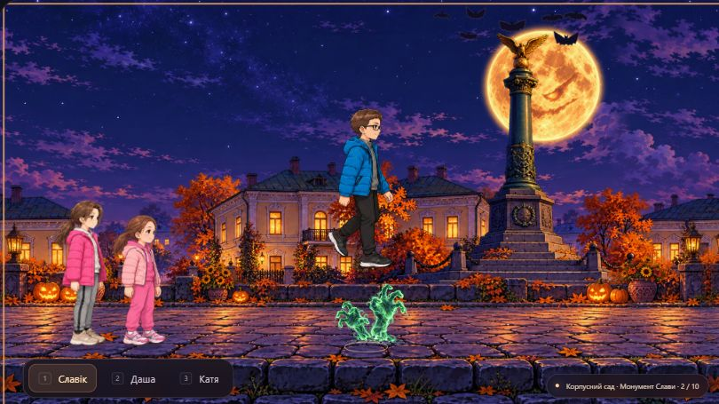

# Славік і друзі — Таємниці Полтави

Офлайн-пригода трьох друзів 12–14 років. На Хелоуїн у їхній ігровій Полтаві відбуваються дивні події. Діти вирішують разом з’ясувати причину.



## Що є у грі

Три персонажі з різним зростом, ходьба, незалежне моргання, стрибки, присідання, падіння з опорою на руки та підйомом. Через випадкові 8–15 секунд спокою герої дістають смартфони на 3–5 секунд. Гра підтримує одночасні дотики двома руками.

Після початку руху два неактивні герої йдуть за обраним на відстані приблизно 5 і 8 кроків. Між супутниками зберігається проміжок із запасом для широких поз ходьби. Руки вони перестрибують автоматично: точка відштовхування обчислюється за висотою перешкоди, швидкістю й силою тяжіння. Якщо місце приземлення зайняте, герой чекає перед руками; якщо для стрибка вже надто близько — спочатку відступає. Після зупинки супутники повертаються до спокою й незалежних циклів смартфона. Початкова розмова та розташування збережені.

Герої починають у центрі сцени й дивляться одне на одного. Початковий діалог пояснює історію. Далі є розмови та реакції на дії: 152 репліки, 17 діалогів, по 12 фраз зі смартфоном на героя. Хмаринки компактні, трохи прозорі, без підписів, із малим жирним шрифтом. Вони враховують положення всіх героїв.

## Нічна Полтава

Карта має 10 стандартних екранів (16 000 × 900). Три перспективи рухаються зі швидкостями 14%, 50% і 100% відносно камери. Уздовж маршруту трапляються Монумент Слави, краєзнавчий музей, садиба Котляревського та Біла альтанка. Ілюстрації створені в тому ж художньому стилі; це ігровий маршрут.

У небі світиться зловісний місяць; над кожною з чотирьох пам’яток літає окрема зграя із семи кажанів з незалежними траєкторіями та змахами крил.

Зелені примарні руки з’являються у випадкових місцях екранів 2–8 при запуску й натисканні «Спочатку». Ціль — 2–3 пари на екран; у зонах пам’яток їх менше або немає. Позиції, напрямки віддзеркалення та фази анімації змінюються між проходами. Вони тягнуться до найближчого героя; їх треба перестрибнути. Дотик або невдалий стрибок відкидає героя назад із наявною анімацією падіння. Стрибок низький, але довгий. Для швидкої перевірки відкрий `?test=hands` після адреси гри.

## Керування

| Дія | Клавіатура |
| --- | --- |
| Обрати героя | 1 — Славік, 2 — Даша, 3 — Катя |
| Рух | ← / → або A / D |
| Стрибок | Пробіл; із напрямком — уперед |
| Присісти | Утримувати ↓ або S |
| Падіння та підйом | Enter |
| Розмова | T або кнопка «Розмова» |

На смартфоні ліва рука керує рухом, присіданням і стрибком на місці. Права кнопка «Уперед» запускає стрибок одним дотиком. «Спочатку» відновлює стартові позиції, напрямки й початкову розмову.

## Завантажити на GitHub

1. Створи репозиторій із гілкою `main`.
2. Завантаж у його корінь вміст цієї папки, включно з `.github/`, `assets/`, `scripts/`, `tests/` та файлами гри. Згенеровані `_site/` і `_offline/` завантажувати не потрібно.
3. У **Settings → Pages → Build and deployment → Source** обери **GitHub Actions**.
4. У **Actions** дочекайся успішного **Check and publish game**. Посилання з’явиться в **Settings → Pages**.

Налаштування публікації описане в [офіційній документації GitHub Pages](https://docs.github.com/en/pages/getting-started-with-github-pages/using-custom-workflows-with-github-pages). Пакет підготовлений локально; публікацію ще потрібно виконати у своєму репозиторії.

## Запуск і перевірки

Потрібний Node.js 22 або новіший. Зовнішніх залежностей немає, `npm install` не потрібний.

```sh
npm start
npm test
npm run build
npm run offline
```

`build` створює `_site/` для Pages. `offline` створює `_offline/slavik-halloween-game.html`, який відкривається без інтернету. Для перевірки вкладеного шляху можна запустити `npm start -- --base=/slavik-and-friends/`.

## Репліки й майбутня озвучка

Редагуй `dialogue-data.mjs`: кожна репліка має ID, мовця, текст і контекст. Мова — `uk-UA`. Профілі зберігають характери, ніки й вік; Славік та Даша — брат і сестра. Текст відокремлений від показу хмаринок, тому пізніше до ID можна прив’язати аудіофайли. Зараз озвучка не підключена.

Усі тексти для читання — у [docs/character-dialogue-uk.md](docs/character-dialogue-uk.md). Технічні правила — у [DEVELOPMENT.md](DEVELOPMENT.md).
